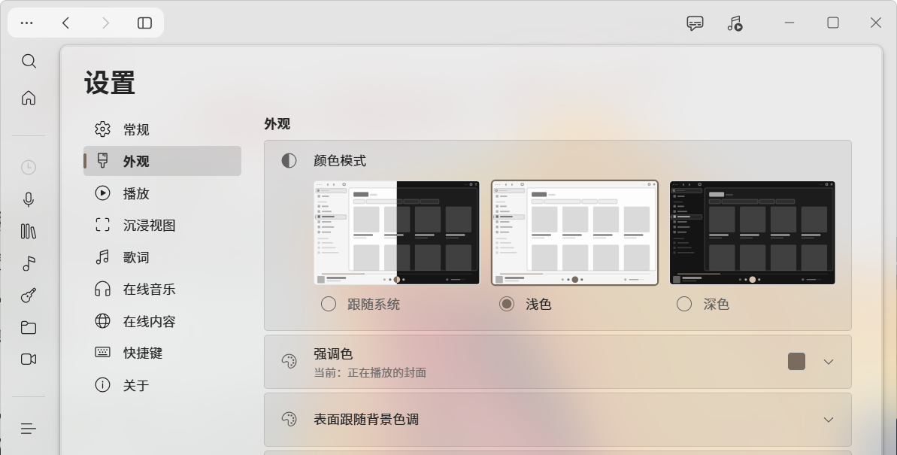
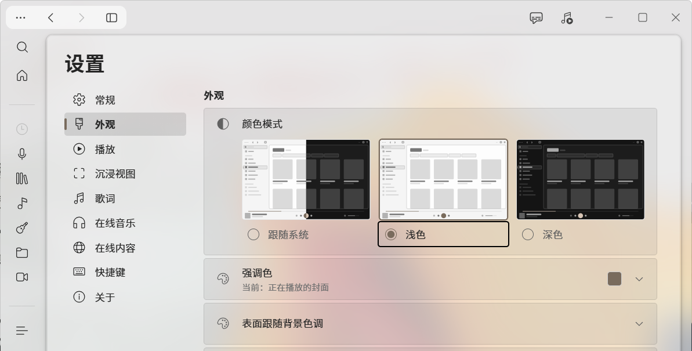

# Foobar Glass Edition

**Foobar Glass Edition** 是基于 **foobar2000 v2.26.2 x64** 的中文便携美化版：界面换成 WebView2 UI，
再用 Windows DWM **Acrylic** 做了一整套半透明毛玻璃皮肤——深色是通透的玻璃，浅色是更亮的半透明；
播放胶囊、内容卡片、对话框都做了磨砂处理，界面全中文。



## 特性

- **真·毛玻璃**：窗口材质走 Windows DWM Acrylic，真实模糊背后的壁纸/窗口，不是画上去的假透明。
- **深色 / 浅色两套玻璃**：深色外壳 `rgba(28,28,28,0.16)`、卡片 `rgba(20,20,20,0.42)`；浅色外壳 `rgba(232,232,232,0.38)`、卡片 `rgba(255,255,255,0.28)`，浅色更亮、更轻。
- **播放胶囊磨砂**：深色 `rgba(14,14,14,0.34)`、浅色 `rgba(250,250,250,0.34)`，配 `blur(30px) saturate(175%)`。
- **卡片磨砂 + 对话框**：卡片 `blur(24px) saturate(150%) brightness(1.05)`；对话框背景压暗 55% + 24px 模糊，面板保持 94% 不透明，字仍然清楚。
- **全中文**：导航、媒体库、播放列表、设置、歌词面板、右键菜单都由主题提供，内置 1600+ 条简体中文文案。
- **便携绿色**：配置、曲库索引、主题都在程序目录里，不写注册表，删文件夹即卸载。

## 截图

| 深色 | 浅色 |
| --- | --- |
|  |  |

> 为保护隐私，截图裁掉了底部播放胶囊区域。

## 下载

- 最新版见 [Releases](../../releases)：`foobar-glass-edition-v1.0.zip` 包含改好的主题前端（`fe/0.3.0`）、玻璃补丁和说明。
- **foobar2000 本体不随包提供**，请自行安装官方 v2.26.2 x64。

## 安装

1. 安装官方 **foobar2000 v2.26.2 x64**（portable 模式即可），并安装组件 **`foo_ui_webview2` 2.1.0**。
2. 把本仓库 `glass/theme-glass.js` 复制为
   `<foobar2000>\profile\webview-ui\default\fe\0.3.0\glass-acrylic.js`；
   或直接把 Release 压缩包里的 `fe/0.3.0` 覆盖到同路径。
3. 确认 `<foobar2000>\profile\webview-ui\default\fe\0.3.0\index.html` 的 `</body>` 之前有一行：

   ```html
   <script src="./glass-acrylic.js"></script>
   ```

4. 启动 foobar2000。

## 已知限制

- **原生对话框仍是英文**：`Ctrl+P` 首选项树（标题 `Preferences: ...`）、属性页、部分消息框属于 Win32 原生资源，不在 WebView2 主题里；组件自带首选项页跟随本体，也是英文。
- **浅色模式的玻璃比深色浅**：两种模式都有玻璃，但浅色整体更亮、更轻（避免浅色字压在深色亚克力上不可读）。
- **背景来源请保持「系统材质」**：主题的「背景来源 = 图片」启动时会报 `背景图片读取失败`，保持 `背景来源 = 系统材质`、`材质 = Acrylic` 即可。
- **在线音乐首次使用需要联网**：主题的在线音乐后端不随包携带，第一次用要在线下载（约 120 MB）。
- **标题栏播放栏由主题按窗口宽度决定**（1008 px 断点），与是否全屏无关；普通窗口想要底部胶囊，请在 `播放栏位置` 选「胶囊」。

## 兼容性

- Windows 10 / 11 x64，需要 **WebView2 Runtime**。
- foobar2000 **v2.26.2 x64** + `foo_ui_webview2` **2.1.0** + 主题 `foo-webview-default-theme` **0.3.0**。

## 许可与致谢

- 主题 `foo-webview-default-theme` 0.3.0：**AGPL-3.0-only**（上游）；`fe-0.3.0/index.html` 是仅加了一行脚本标签的本地修改版，仍按 AGPL-3.0 提供。
- `foo_ui_webview2` 2.1.0：**GPL-3.0**（上游）。
- foobar2000：freeware，**本仓库不包含其二进制**。
- 本仓库的补丁脚本与文档：作者自用整理，未附带单独的开源许可文件。

## 隐私

- 截图已裁掉底部 140 px 播放胶囊区域，不含正在播放的曲目与封面。
- 本仓库与 Release 包不含 `profile\`、网易云登录态、本地曲库、播放列表或 WebView2 用户数据。
