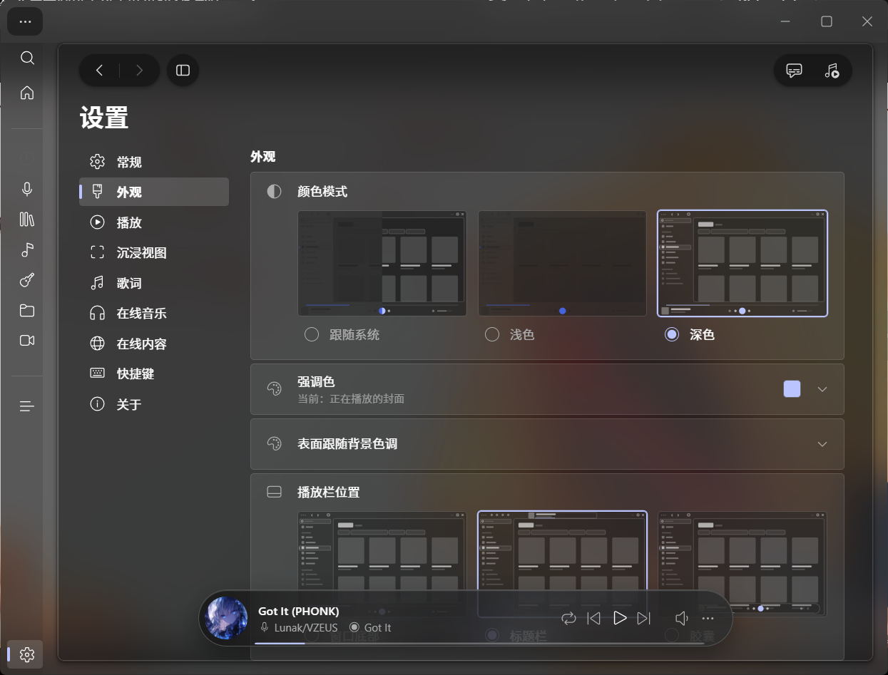
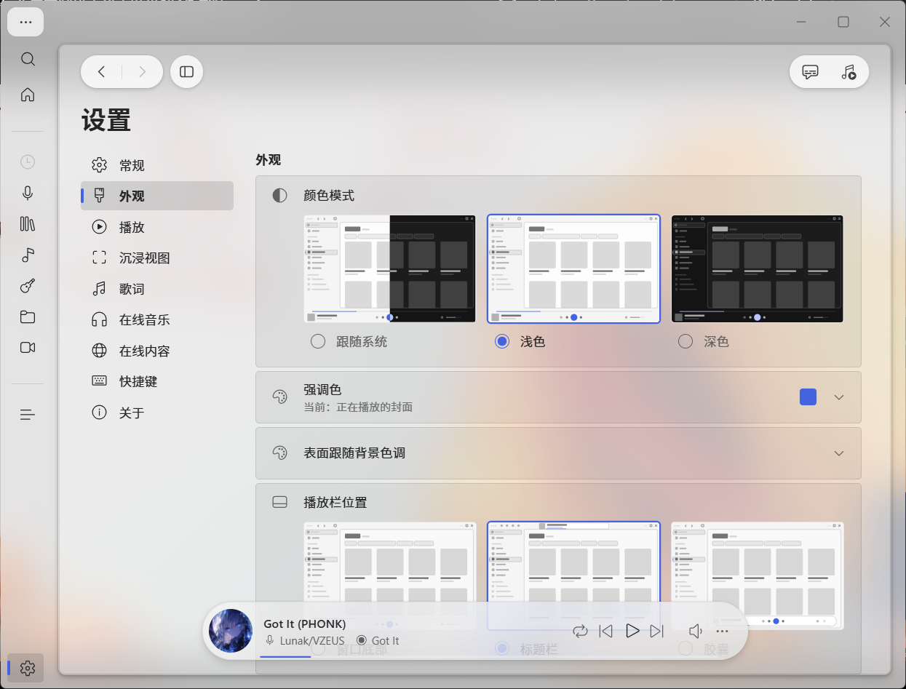

# Foobar Glass Edition

**English** | [简体中文](#简体中文)

A portable, glass-skinned build of **foobar2000 v2.26.2 x64** with the WebView2 UI. The window uses
Windows DWM **Acrylic** for real backdrop blur, and the theme gets a full translucent treatment in both
colour modes — frosted player capsule, frosted content card and a dimmed/blurred dialog scrim.
The interface is **bilingual (Simplified Chinese / English)** and follows the theme's language setting.



## Features

- **Real acrylic blur** — Windows DWM Acrylic; the backdrop is actually blurred, not a painted fake transparency.
- **Dark & light glass** — dark shell `rgba(28,28,28,0.16)` / card `rgba(20,20,20,0.42)`; light shell `rgba(232,232,232,0.38)` / card `rgba(255,255,255,0.28)`. Light is brighter and lighter on purpose.
- **Frosted player capsule** — dark `rgba(14,14,14,0.34)`, light `rgba(250,250,250,0.34)`, with `blur(30px) saturate(175%)`.
- **Frosted card + dialog** — card `blur(24px) saturate(150%) brightness(1.05)`; dialog backdrop dimmed 55% + 24px blur, panel stays 94% opaque.
- **Bilingual interface** — Simplified Chinese and English, switchable in Settings (the theme ships i18n).
- **Portable** — config, library index and theme live inside the app folder; nothing in the registry; delete the folder to uninstall.

## Screenshots

| Dark | Light |
| --- | --- |
|  |  |

> Screenshots include the frosted player capsule at the bottom.

## Download

- Latest: [Releases](../../releases) — `foobar-glass-edition-v1.0.zip` contains the modded theme frontend (`fe/0.3.0`), the glass patch and the docs.
- **foobar2000 itself is not bundled** — install the official v2.26.2 x64 yourself.

## Install

1. Install the official **foobar2000 v2.26.2 x64** (portable is fine) and the **`foo_ui_webview2` 2.1.0** component.
2. Copy `glass/theme-glass.js` to `<foobar2000>\profile\webview-ui\default\fe\0.3.0\glass-acrylic.js`, or overwrite `fe/0.3.0` with the folder from the release zip.
3. Make sure `<foobar2000>\profile\webview-ui\default\fe\0.3.0\index.html` contains this line before `</body>`:

   ```html
   <script src="./glass-acrylic.js"></script>
   ```

4. Start foobar2000.

## Known limitations

- **Native dialogs stay English** — the `Ctrl+P` preferences tree (`Preferences: ...`), property pages and some message boxes are Win32 resources outside the WebView2 theme; component preference pages follow the player and are English too.
- **Light-mode glass is brighter than dark** — both modes are glassy, but light is intentionally lighter so text stays readable over dark acrylic.
- **Keep Background source = System material** — the theme's Image background reports `背景图片读取失败` at startup; keep `Background source = System material`, `Material = Acrylic`.
- **Online music needs a one-time download** — the theme's online-music backend is not bundled; the first use downloads it (~120 MB).
- **Title-bar player depends on window width** (1008 px breakpoint), not on fullscreen; choose **Capsule** in *Playbar position* for normal windows.

## Compatibility

- Windows 10 / 11 x64, with **WebView2 Runtime**.
- foobar2000 **v2.26.2 x64** + `foo_ui_webview2` **2.1.0** + theme `foo-webview-default-theme` **0.3.0**.

## License

- Theme `foo-webview-default-theme` 0.3.0: **AGPL-3.0-only** (upstream); `fe-0.3.0/index.html` is a local modification (one `<script>` tag) and stays under AGPL-3.0.
- `foo_ui_webview2` 2.1.0: **GPL-3.0** (upstream).
- foobar2000: freeware; **its binaries are not included** here.
- The glass patch scripts and docs: personal-use release, no separate licence file.

---

<a id="简体中文"></a>
# 简体中文

基于 **foobar2000 v2.26.2 x64** 的便携毛玻璃美化版，界面换成 WebView2 UI，用 Windows DWM **Acrylic**
做真实背景模糊，深色/浅色两套半透明玻璃，播放胶囊、内容卡片、对话框都做磨砂处理。
界面**双语（简体中文 / English）**，跟随主题的语言设置切换。


## 特性

- **真·毛玻璃**：窗口材质走 Windows DWM Acrylic，真实模糊背后的壁纸/窗口，不是画上去的假透明。
- **深色 / 浅色两套玻璃**：深色外壳 `rgba(28,28,28,0.16)`、卡片 `rgba(20,20,20,0.42)`；浅色外壳 `rgba(232,232,232,0.38)`、卡片 `rgba(255,255,255,0.28)`，浅色更亮、更轻。
- **播放胶囊磨砂**：深色 `rgba(14,14,14,0.34)`、浅色 `rgba(250,250,250,0.34)`，配 `blur(30px) saturate(175%)`。
- **卡片磨砂 + 对话框**：卡片 `blur(24px) saturate(150%) brightness(1.05)`；对话框背景压暗 55% + 24px 模糊，面板保持 94% 不透明，字仍然清楚。
- **双语界面**：简体中文与 English，在设置里切换（主题自带 i18n）。
- **便携绿色**：配置、曲库索引、主题都在程序目录里，不写注册表，删文件夹即卸载。

## 截图

| 深色 | 浅色 |
| --- | --- |
|  |  |

> 截图保留了底部的磨砂播放胶囊。

## 下载

- 最新版见 [Releases](../../releases)：`foobar-glass-edition-v1.0.zip` 包含改好的主题前端（`fe/0.3.0`）、玻璃补丁和说明。
- **foobar2000 本体不随包提供**，请自行安装官方 v2.26.2 x64。

## 安装

1. 安装官方 **foobar2000 v2.26.2 x64**（portable 模式即可）和组件 **`foo_ui_webview2` 2.1.0**。
2. 把 `glass/theme-glass.js` 复制为 `<foobar2000>\profile\webview-ui\default\fe\0.3.0\glass-acrylic.js`，或用 Release 压缩包里的 `fe/0.3.0` 目录覆盖。
3. 确认 `<foobar2000>\profile\webview-ui\default\fe\0.3.0\index.html` 的 `</body>` 之前有这一行：

   ```html
   <script src="./glass-acrylic.js"></script>
   ```

4. 启动 foobar2000。

## 已知限制

- **原生对话框仍是英文**：`Ctrl+P` 首选项树（标题 `Preferences: ...`）、属性页、部分消息框属于 Win32 原生资源，不在 WebView2 主题里；组件自带首选项页跟随本体，也是英文。
- **浅色模式的玻璃比深色浅**：两种模式都有玻璃，但浅色整体更亮、更轻（避免浅色字压在深色亚克力上不可读）。
- **背景来源请保持「系统材质」**：主题的「背景来源 = 图片」启动时会报 `背景图片读取失败`，保持 `背景来源 = 系统材质`、`材质 = Acrylic` 即可。
- **在线音乐首次使用需要联网**：主题的在线音乐后端不随包携带，第一次用要在线下载（约 120 MB）。
- **标题栏播放栏由主题按窗口宽度决定**（1008 px 断点），与是否全屏无关；普通窗口想要底部胶囊，请在 `播放栏位置` 选「胶囊」。

## 兼容性

- Windows 10 / 11 x64，需要 **WebView2 Runtime**。
- foobar2000 **v2.26.2 x64** + `foo_ui_webview2` **2.1.0** + 主题 `foo-webview-default-theme` **0.3.0**。

## 许可与致谢

- 主题 `foo-webview-default-theme` 0.3.0：**AGPL-3.0-only**（上游）；`fe-0.3.0/index.html` 是仅加了一行脚本标签的本地修改版，仍按 AGPL-3.0 提供。
- `foo_ui_webview2` 2.1.0：**GPL-3.0**（上游）。
- foobar2000：freeware，**本仓库不包含其二进制**。
- 本仓库的补丁脚本与文档：作者自用整理，未附带单独的开源许可文件。
